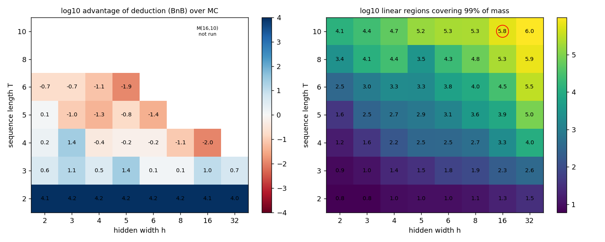
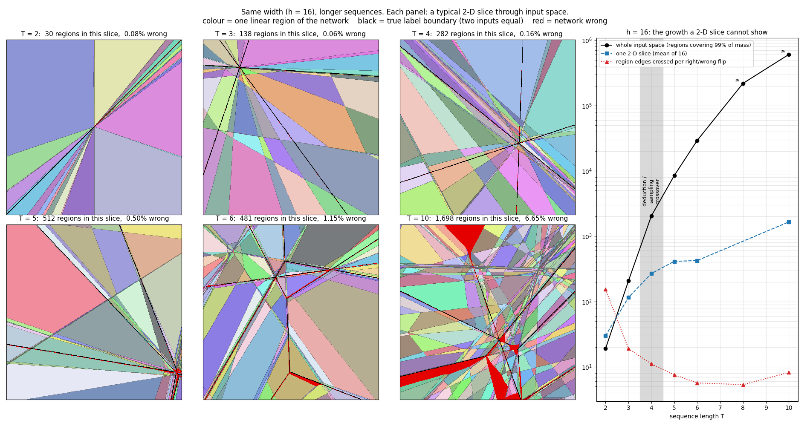

# Where deduction beats sampling: a map of the 2nd-argmax RNN family

**Left:** log10 of the advantage of a generic deductive estimator over random sampling, for
the best zoo model at each width h and sequence length T. Advantage = MC compute needed for
the same rms error ÷ deductive compute. Blue means deduction wins and red means sampling wins.
**Right:** linear regions covering 99% of the input mass (n99). The challenge model
M(16,10), circled, has about 6×10^5.

**What the ramp looks like** (`survey/slices.py`). Each panel is a typical 2-D slice of input
space for the h = 16 zoo model, with linear regions coloured, true label walls in black and
errors in red. The panes shrink and the red slivers along the walls widen as T grows. The
right-hand panel shows why a slice understates the problem: a slice gains regions only
slowly, while the whole space gains about 10× per step. The growth is in the dimensions a
picture cannot show.

## The map

| T | Advantage across h = 2…32 | Winner |
|---|---|---|
| 2 | ≥ 10^4 everywhere (lower bound: BnB is limited by the precision of the truth) | deduction, overwhelmingly |
| 3 | 1.3 – 25 | deduction, narrowly |
| 4 | 25 (h3) falling to 0.011 (h16) | sampling, except at the smallest widths |
| 5 | 0.04 – 1.2 | sampling |
| 6 | 0.01 – 0.2 | sampling |
| 8, 10 | not run (regions 10^3.4 – 10^6) | sampling, by extrapolation |

- **The crossover is at T ≈ 3–4.**
- **Each step of sequence length costs about three orders of magnitude.** At h16 the
  advantage goes 10^4 → 10 → 0.01 for T = 2, 3, 4. M(16,10) is six steps past the
  crossover, with roughly 300× more regions than h16T4.
- **Width matters too, but less.** Regions grow roughly like (hT)^T: polynomial in width,
  with sequence length as the degree. At T = 2 width is almost free (n99 6 → 31 from h2
  to h32). At T = 6 it is not (344 → 3×10^5). Each extra step adds a dimension in which
  the h new cuts multiply, so the nonlinearities compound in time, not across width.
- **Region count is geometry, not packing.** The spare-capacity h32 models have the most
  regions and the highest kink density at every T (`survey/survey.json`). A large region
  count therefore does not show that a model is "packed"; it is what any ReLU RNN with
  long inputs looks like.

## The counterpoint: an explained model at T = 10

`hand10` is a hand-built 2nd-argmax RNN (h = 22, T = 10, 726 parameters, accuracy
0.9903). Generic region enumeration is hopeless for it too (n99 ≈ 10^5). But its
explanation turns the problem into something deductive:

- It is built to track the maxima of the positive parts of the inputs exactly. With at
  least two positive inputs, sampling finds no errors. We read that as exact by
  construction but have not proved it. That event has mass 1013/1024 exactly.
- Only the remaining 11/1024 (at most one positive input) needs sampling. There the
  conditional accuracy is 0.10 (none positive) and 0.096 (one positive).
- Sampling only that stratum cuts variance about 950× at equal compute, at T = 10. That
  is far beyond anything we achieved on M(16,10) (~2–3×).

So the map is about **generic** deduction, meaning enumerating linear regions. An
explanation that groups a huge set of regions into one analytically known event escapes
the map. For hand10 the explanation does exactly that. For M(16,10) the best explanation
we found (EXPLAINER §8) puts the error in tie layers whose widths depend on multi-neuron
kinks at ~1% relative precision. That error set does not group into events of known mass,
and every attempt to make it do so cost more than sampling (§10, §11).

## The T = 10 family under the same lenses

| model | acc | best unbiased gain vs MC | FORM level (deduced / actual tie error) | surprise left after tie layer | bg-gradient / tie slope | active-subspace dim |
|---|---|---|---|---|---|---|
| h8, zoo best (failed) | 0.427 | 2.7x (gaps+pos, pilot) | 0.22 / 0.48 (-54%) | 92% | 0.66, 1.02 | 3.8, 5.2 |
| h16 seeds 0-4 | 0.88-0.95 | 2.9-3.2x (gaps+pos, pilot); 3.2-6.1x (stacked, no pilot, seeds 0-2 at 2^17-2^19, 48 reps; 3.7-5.9x with the Sobol stream) | -34% to +44%, rms 19% over the harness | 71% (seed0) | 0.15-0.23 | ~4-5 |
| M(16,10) | 0.953 | 3.4x (gaps+pos, pilot); 6.1-6.3x (stacked, no pilot, 2^17-2^19, 48 reps; 10-12x with the Sobol stream) | 0.0386 / 0.0392 (-2%) | 57% | 0.14, 0.08 | 4.0, 4.7 |
| h32, zoo best | 0.994 | 6.8x (gaps) | 0.0048 / 0.0053 (-8%) | 45% | 0.04, 0.02 | 3.0, 3.5 |
| hand10 | 0.990 | 163x (gaps), ~950x (its own event) | 0 / 0.0012 (no strip; the error is the vS < 0 event) | 6% | 0.00 | strip width 0 |

Columns: gain from `probes/ablation.out` and `probes/best_unbiased.out`; FORM level from
`probes/form_abs_all.out` and `probes/family.out`; surprise and active subspace from
`probes/surprise*.out`, `probes/family.out`. The ordering column is the background-gradient
to tie-slope ratio: how much the inputs other than the tied pair move the decision. At 1.0
the comparator is incoherent and nothing deduces; at 0 the strip has no width and the error
is one event of known mass.

## What the challenge model is, on this map

M(16,10) sits six sequence steps past the generic crossover, with ~6×10^5 regions
covering 99% of the mass and an estimated half of the mass in regions never seen in 2^20
samples (Good–Turing).
Our mechanism-level tools behave the same way:

- deductive or biased estimators lose to MC above ~0.4 MFLOP on the perturbed models;
- unbiased sampling designed from the mechanism (stratification on tie gaps, RQMC in
  order-statistic coordinates) gains 1.3–3×; adaptive Neyman allocation over gaps and
  the positions of the top three, with no pilot, 2.4–5.5× at 2^20
  (`probes/strat_adaptive.py`); stacked with the exact integral of the last input,
  4.4-4.9x (geometric mean over the trained model, two copies and three seeds at 2^17-2^19, 48 reps; 3-6x per model), and 5-7x with a scrambled-Sobol stream inside the strata (24 reps; trained 10-12x) (`probes/best_unbiased.py`);
- control variates or proportional strata on the top-3 order statistics are capped at
  ~2–4×. Predicting per-stratum error rates from the weights is untried; learning them
  on the way costs nothing measurable above 2^18 samples.

The challenge asks for deduction at the point in model space where both generic and
mechanism-guided deduction are weakest. Nearby points either have short sequences
(generic deduction wins outright) or a simple error set (hand10, explanation-guided
deduction wins by ~950×).

## Method

- **Models:** best seed per (h, T) from the zoo (`alg_zoo.zoo_2nd_argmax`), plus
  handcrafted hand2, hand3 and hand10. `survey/survey.py` gives accuracy, n99,
  Good–Turing unseen mass, and kinks per correct/wrong flip along great circles.
- **Deductive estimator (`survey/bnb.py`):**
  - Branch-and-bound over activation patterns: split on the sign of one neuron's
    pre-activation at a time. Each leaf is a polyhedron on which the network is linear.
  - Gaussian mass is computed by separation of variables. x_0 … x_{T−2} go on a fixed
    scrambled Sobol lattice of Q points; x_{T−1} is integrated exactly through Φ.
  - Correctness is exact in x_{T−1} via its breakpoints.
  - Children below mass eps are dropped and recorded as `lost`.
  - No network samples are drawn.
- **Truth:** MC at 2^27 (float64).
- **Grid (`survey/crossover.py`):**
  - eps ∈ {1e-3 … 1e-6} × Q ∈ {64 … 4096}, 3 lattice scrambles each. Best configuration
    reported.
  - MC cost is p(1−p)·F / rms², with F = T(2h²+2h) + 2Th FLOPs per sample.
- **Convergence check (`survey/bnb_conv.py`, h6T3):**
  - 8 scrambles, Q from 256 to 65536. No bias: every |bias| is under 2 standard errors,
    and the truth's standard error is 2.4e-6.
  - The spread falls about as Q^-0.6.

## Caveats

- **The deductive estimator is partly a sampler.** Its lattice over T−1 inputs converges
  at close to the MC rate, because the integrand is discontinuous at region boundaries.
  Its edge is one exactly integrated dimension plus the region structure. That explains
  why it dominates at T = 2 (one lattice dimension) and fades as T grows. A fully exact
  polytope integrator would cost more per region, not less.
- **Verifier-style pruning can't move the crossover.** Certifying regions as all-correct
  or all-wrong, as α,β-CROWN does, finds nothing to prune before the last step
  (`survey/purity_ceiling.py`: pure mass 0.000 at every earlier depth, T = 3–6). The label
  depends on inputs not yet read.
- **The best configuration is chosen against the truth.** That is optimistic for
  deduction. The MC baseline is plain sampling; against RQMC (2–3× better) every
  advantage drops by that factor.
- **One model per cell and one deductive design.** Many small-h, long-T zoo models are
  poor (accuracy 0.2–0.5). Their larger p(1−p) makes MC noisier and so favours deduction,
  and it still loses there.
- **The grid stopped at n99 ≈ 2000** (killed by memory pressure). Cells with T ≥ 8, and
  larger-h cells at T = 4–6, are unrun. n99 for those is a lower bound: the Good–Turing
  unseen mass reaches 0.2–0.9.
- **Only one explained long-T model.** hand10 shows explanation-guided deduction can win
  at T = 10. It does not show where that stops working between hand10 and M(16,10).
